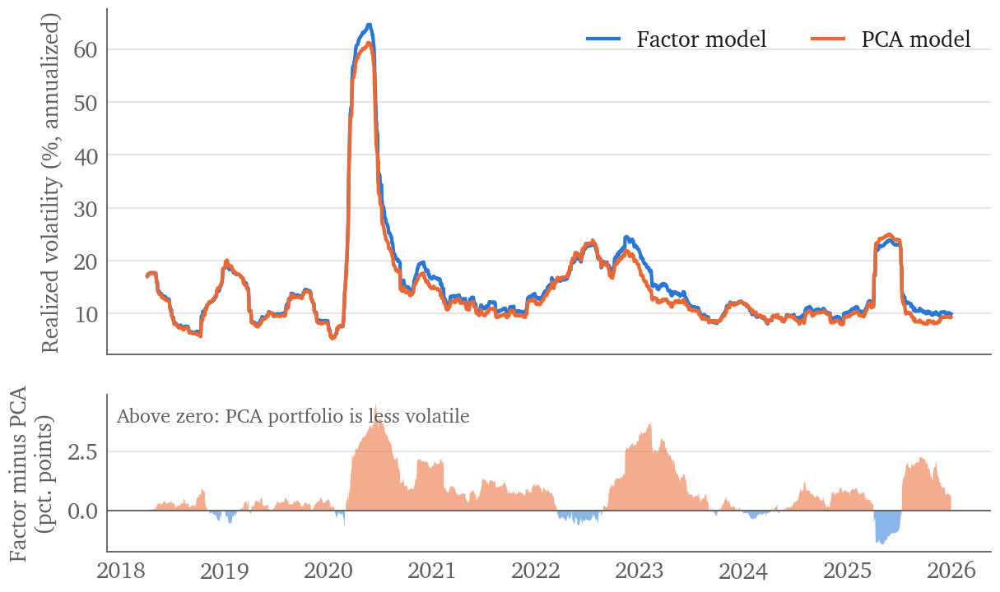
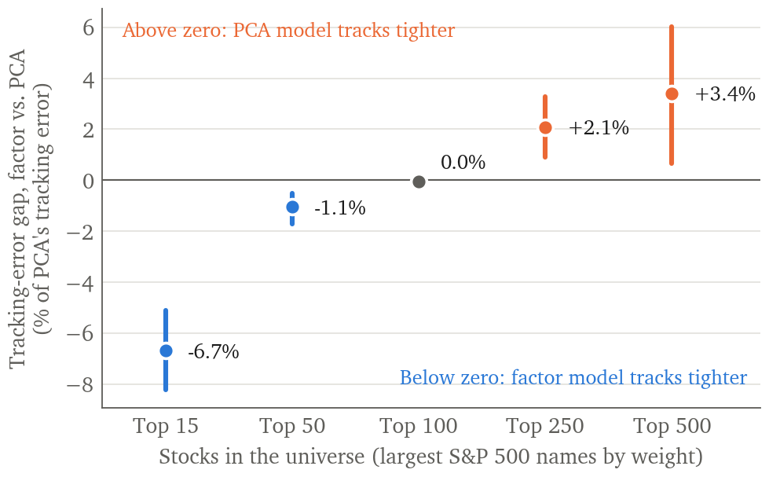
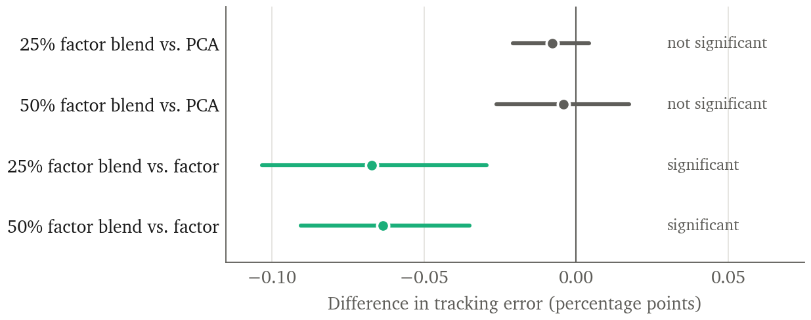
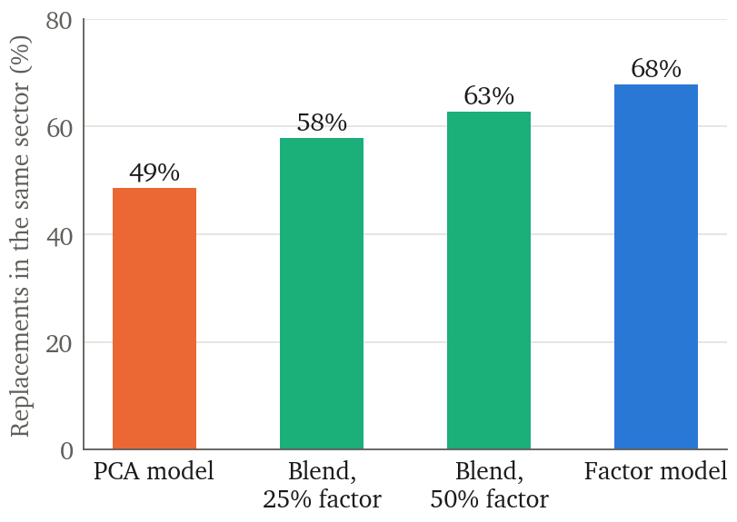

# Fundamental Factors vs. PCA: Comparing Two Risk Models for Tracking the S&P 500

An out-of-sample study for direct indexing, 2018 to 2025.

Rayhan Driver, with Tommy Bobitz (partner intern). Research from a Summer 2026 internship at Alphathena.

**[Read the full paper (PDF, 14 pages)](whitepaper.pdf)**

## Summary

Direct indexing means holding the individual stocks of an index instead of a fund. To follow an index with far fewer stocks than it contains, an optimizer needs a risk model, which estimates how every stock moves with every other.

The firm's existing risk model finds its risk drivers statistically from price history, using principal component analysis (PCA). My partner intern and I built an alternative, a fundamental factor model, which names its drivers in advance: nine style factors such as value, momentum, and size, plus the eleven GICS sectors.

We then tested the two models against each other on data neither had seen. Both models were rebuilt every month from 2018 through 2025 using only the information available on that day, and scored on what their portfolios actually did over the following month.

Our model lost on the main test, since PCA produced slightly lower risk on a broad S&P 500 portfolio. The more useful result was a clear picture of the conditions under which each model performs better.

| Measure (S&P 500 universe, 96 monthly rebalances) | Factor | PCA | Better |
|---|---:|---:|---|
| Volatility of the minimum-variance portfolio | 17.93% | 17.07% | PCA, significant |
| Tracking error against the S&P 500 | 1.80% | 1.74% | PCA, significant but small |
| Turnover of the minimum-variance portfolio | 0.208 | 0.278 | Factor, about 25% less |
| Sharpe ratio of the minimum-variance portfolio | 0.567 | 0.520 | Factor, not tested |

## Main findings

### 1. PCA forecast risk slightly better on a broad portfolio

The gap was small but consistent across the test period, and it held up under a block bootstrap.

### 2. The better model depends on portfolio size

The factor model tracked the index better on small universes and PCA tracked better on large ones, with the two level at around 100 names. A follow-up using randomly drawn universes showed that this is partly a real small-universe effect and partly an effect of the very largest companies.

### 3. A blend of the two models matched PCA but did not beat it

A first look suggested the blend was better than either model alone. The significance test showed that its edge over PCA was within the noise, so we corrected the claim.

### 4. The factor model picked more recognizable tax-loss replacements

When a stock is sold to realize a loss, the factor model's replacement was in the same sector 68% of the time, compared with 49% for PCA.

The paper also covers the checks we ran on the fairness of our own comparison, two experiments that did not improve the model, and the study's limitations. The most important limitation is that the style scores we used were partly derived from prices.

## Repository contents

| Path | Contents |
|---|---|
| `whitepaper.pdf` | The full paper |
| `figures/` | Each figure as PNG and PDF |
| `paper/whitepaper.tex` | LaTeX source for the paper |
| `paper/make_figures.py` | The matplotlib script that draws the figures from saved results |

The project's codebase and data belong to Alphathena and are not included. The paper contains three short excerpts of code I worked on to illustrate the methods: the daily cross-sectional regression, the model blend, and the block bootstrap.

## Methods and tools

Python (pandas, NumPy, SciPy), cross-sectional weighted least squares, exponentially weighted covariance estimation, walk-forward backtesting with point-in-time data, constrained portfolio optimization, and stationary block bootstrap for significance.

---

This is my own account of the research, written for a general technical reader. It is not an Alphathena publication and nothing in it is investment advice. The portfolios are research constructions, not client results.
